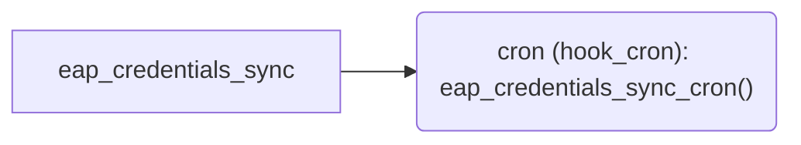

# Integrations — generated (`node .ai/scripts/ai.mjs integrations --update`)

What the system exchanges with the outside and what runs on its own. The tables are generated from code and config;
write the **why**, **how it fails** and **how to test it locally** between each `notes` marker — that part is kept.

## cron (hook_cron)

### eap_credentials_sync_cron() — `cron:eap_credentials_sync`

- internal · module eap_credentials_sync · `eap/modules/eap_credentials_sync/eap_credentials_sync.module:113`

<!-- notes:cron:eap_credentials_sync -->
_Why it exists · how it fails · how to test it locally — to be written by a human._
<!-- /notes -->
